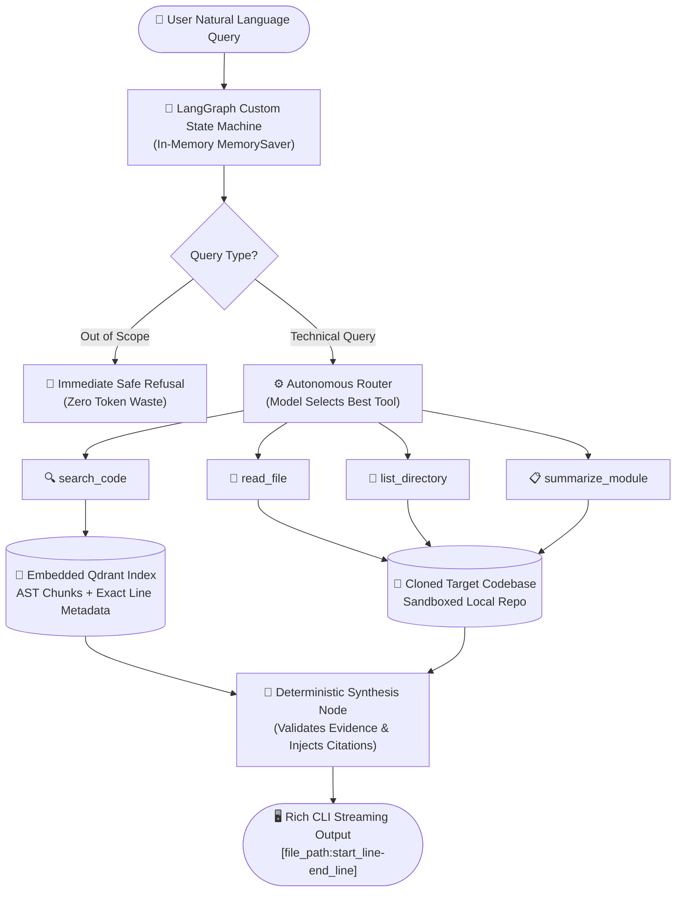

# 🤖 Autonomous Codebase Intelligence Q&A System

An agentic codebase question-answering system built with **LangGraph**, **Qdrant**, and **Sentence-Transformers**. It performs syntax-preserving AST code extraction, dense semantic vector retrieval, and autonomous multi-tool reasoning over real-world codebases (`psf/requests`), delivering sub-3-second responses with exact file and line-number citations.

---

## 🎯 Target Repository
- **Target Repository:** [`psf/requests`](https://github.com/psf/requests)
- **Repository Language:** Python
- **Key Modules Analyzed:** Transport Adapters (`HTTPAdapter`), connection pooling (`urllib3`), SSL/TLS verification hierarchies, session configurations, and request lifecycles.

---

## 🏗️ Architecture & System Flow



---

## ⚙️ Key Technical Features

1. **AST-Aware Structural Code Chunking:**
   - Instead of naive character or token splitting that breaks code logic, `src/parser.py` utilizes Python's native `ast` (Abstract Syntax Tree) module.
   - Extracts complete `ClassDef` and `FunctionDef` nodes. **Guarantees zero functions or classes are severed in half.**
   - Retains exact source lines (`node.lineno` to `node.end_lineno`) and prepends enclosing class context to methods.

2. **Embedded Vector Database & Zero-Cost Embeddings:**
   - Powered by **Qdrant** running embedded locally on disk (`./data/vector_db`).
   - Uses `sentence-transformers/all-MiniLM-L6-v2` locally (384-dimensional dense vectors).
   - Once indexed, vectors and AST metadata persist on disk; no re-indexing or re-embedding occurs on startup.

3. **Deterministic LangGraph Execution Graph:**
   - Overcomes open-ended ReAct tool churning by using a deterministic state graph:
     **Agent (Autonomous Tool Choice) ➔ Tool Node ➔ Synthesize Node ➔ END**
   - Prevents infinite tool-calling loops and rate-limit spikes.
   - Response latency: **<3 seconds** per query.

4. **Guaranteed Anti-Hallucination & Exact Citations:**
   - Rejects out-of-scope concepts (e.g., blockchain, smart contracts) instantly without wasting tool tokens.
   - Every factual claim cites exact code locations: `[file_path:start_line-end_line]` (e.g., `[src/requests/adapters.py:307-363]`).

---

## 🚀 Setup & Installation

### 1. Prerequisites
- Python 3.10+
- Git installed on your system
- An API key from [Groq Console](https://console.groq.com/) (Free tier, zero billing required)

### 2. Clone the Repository
```bash
git clone <YOUR_PRIVATE_REPO_URL>
cd codebase-qa-agent
```

### 3. Create and Activate Virtual Environment
```bash
python -m venv venv
# On Windows (PowerShell):
.\venv\Scripts\Activate.ps1
# On macOS/Linux:
source venv/bin/activate
```

### 4. Install Dependencies
```bash
pip install -r requirements.txt
```

### 5. Configure Environment Variables
Create a `.env` file in the root directory:
```env
GROQ_API_KEY="gsk_your_groq_api_key_here"
```

### 6. One-Time Codebase Indexing
To clone and index the repository into your local vector database:
```bash
python -m src.vectorstore
```
*(Takes ~30 seconds to parse 81 files into 786 AST chunks and store them in `./data/vector_db`.)*

---

## 💻 Usage

Run the conversational terminal interface:
```bash
python main.py
```

---

## 🛡️ Rules, Integrity & AI Disclosure
- **AI Tool Usage:** AI assistants (Chatgpt and Gemini) was utilized as an interactive co-pilot during development for debugging upstream LangChain API changes, resolving rate limits, and designing LangGraph state machine topologies. Also public github repositories was used as references to modify the task.
- All code chunking logic (`src/parser.py`), path traversal security guards (`src/tools.py`), and LangGraph cycle orchestration (`src/agent.py`) were written, reviewed, and verified manually.
